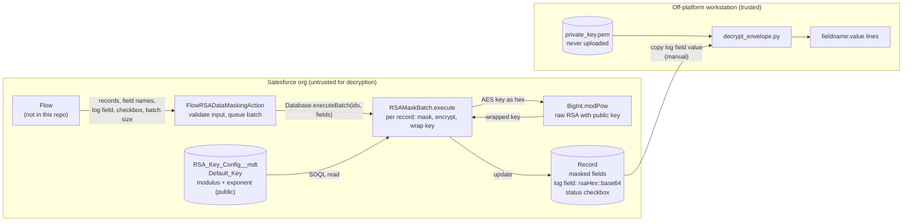

# salesforce-hybrid-asymmetric-encryption-in-flow

Mask personal information (PI) in Salesforce records with an RSA-2048 and AES-256 envelope, so that the key able to reverse the masking is never stored in the org.

> **Status: proof of concept.** The RSA step uses raw ("textbook") RSA without padding and a hand-written big-number class. Nobody independent has reviewed the cryptography. Read [Limitations](#limitations) before using this on real data.

## Contents

1. [Summary](#summary)
2. [Use cases and non-use cases](#use-cases-and-non-use-cases)
3. [Architecture](#architecture)
4. [Key handling](#key-handling)
5. [Threat model](#threat-model)
6. [Design decisions](#design-decisions)
7. [Limitations](#limitations)
8. [Test steps](#test-steps)
9. [Demo](#demo)
10. [Security reporting](#security-reporting)
11. [Licence](#licence)

Supporting documents: [reference](docs/reference.md) (Flow inputs, masking rules), [full threat model](docs/threat-model.md), [claim-by-claim verification](docs/verification.md), [unverified items](docs/unverified.md) and the [demo script](docs/demo-script.md).

---

## Summary

A Salesforce Flow passes a collection of records, a list of field API names, a log field and a status checkbox to an Apex invocable action. The action validates the input and queues a batch job. For each record, the batch joins the chosen field values into one text payload, encrypts it with a freshly generated AES-256 key, encrypts that AES key with an RSA public key held in Custom Metadata, and writes `<RSA hex>::<AES payload, base64>` into the log field. It then blanks or replaces the original fields and ticks the status checkbox. Salesforce holds only the public key. Reversing the masking needs the RSA private key, which is generated and kept off-platform, and the supplied Python script `decrypt_envelope.py`. There is no in-org unmask action.

(Sources: `FlowRSADataMaskingAction.processRecords`, `RSAMaskBatch.execute`, `decrypt_envelope.py`.)

## Use cases and non-use cases

**Suitable for**

- Hiding PI on records that have reached the end of a retention period, where the data must stay recoverable for a small, controlled group but should not be readable by anyone with access to the org, its exports or its metadata.
- Learning and demonstration: how to implement an envelope-encryption pattern in Apex, expose it to Flow, and decrypt it elsewhere.

**Illustrative scenario.** A Scheduled Flow selects records that meet a retention condition (for example no recent activity and no active ongoing commitment), checks parent-record dependencies (for example through a roll-up on the parent account so that a contact is masked only when every sibling also qualifies), routes the set for manual approval, and on the next run passes the approved records to this action. This Flow is the author's design for illustration. It is **not** included in the repository and is not tested here.

**Not suitable for**

- Anything that needs the data restored inside Salesforce. There is no in-org decryption. Use the sister repository, [salesforce-aes256-encryption-in-flow](https://github.com/jyltsang/salesforce-aes256-encryption-in-flow), if you accept that its key sits in the org.
- Protecting data from someone who can modify the org's metadata *before* masking runs. They could replace the public key with their own (see [threat model](#threat-model)).
- Real-time masking at scale. Processing runs in an asynchronous batch and the RSA arithmetic is done in Apex. The repository contains no performance measurements.
- Production use on regulated data without an independent cryptographic and security review.
- Replacing Salesforce's own platform encryption, field-level security, sharing rules or backup controls. This project does not touch them.

## Architecture



Envelope format, as produced by `RSAMaskBatch.execute` and consumed by `decrypt_envelope.py`:

```
<RSA-wrapped AES key, lower-case hex> "::" <base64( IV(16 bytes) || AES-256-CBC ciphertext )>
```

The plaintext inside the AES layer is one `lowercasefieldname:value` line per masked field, joined by newlines. Field names are therefore inside the ciphertext, unlike the sister repository.

The IV, CBC mode and PKCS7 padding come from `Crypto.encryptWithManagedIV('AES256', …)`; this repository relies on the script's assumption that this matches Salesforce's behaviour (see [unverified items](docs/unverified.md)).

## Key handling

| Key | Where it lives | Who can access it | How it is generated | Notes |
|---|---|---|---|---|
| **RSA private key** | An offline PEM file, e.g. `private_key.pem`. Never in Salesforce. `.gitignore` excludes `*.pem`. | Whoever holds the file. The repository enforces nothing about storage. | Off-platform: `openssl genrsa -out private_key.pem 2048` | Losing it means the data cannot be recovered. `decrypt_envelope.py --password` supports a passphrase-protected PEM, but the generation command shown does not add one. |
| **RSA public key** | Custom Metadata record `RSA_Key_Config__mdt` named `Default_Key`: `Modulus__c` (512 hex characters) and `Exponent__c` (`10001`). | Anyone who can read Custom Metadata or run Apex in the org. It is public by design. | Derived from the private key (`openssl rsa -noout -modulus`) | Confidentiality is not needed; **integrity** is. Whoever can edit this record controls which private key can read future envelopes. |
| **AES session key** | Memory only, inside `RSAMaskBatch.execute`, for the duration of one record. | Apex running that transaction. | `Crypto.generateAESKey(256)`, fresh for every record | Stored only in wrapped form. The code does not log it. |
| **Test modulus** | `RSAMaskBatchTest` | n/a | The string `ffff…` (512 characters). It is **not** a real key. | Tests inject it through `RSAMaskBatch.testConfigs`. |

**Rotation.** There is none. The batch reads only the record named `Default_Key`, and the envelope carries no key identifier. If you replace the public key, earlier envelopes still need the old private key and nothing in the log says which one that was. Keep that mapping outside Salesforce.

## Threat model

Summary only; scenarios, assumptions and mitigation ideas are in [docs/threat-model.md](docs/threat-model.md).

**Assets**

| Asset | Why it matters |
|---|---|
| Original PI values before masking | The data being protected |
| The envelope in the log field | The only copy of the PI after masking; losing or altering it loses or corrupts the data |
| RSA private key | Grants decryption of every envelope made with the matching public key |
| Public key record (`Default_Key`) | Decides who can read future envelopes |
| Apex classes and Flow configuration | Decide what is masked and how |

**Actors**

| Actor | Assumed capability |
|---|---|
| Standard user with record access | Reads masked records and the log field |
| Org administrator or metadata deployer | Reads and edits Custom Metadata, Apex and Flows; can run the action |
| Insider with data export rights | Obtains records, including log fields |
| Attacker with stolen org credentials | As the account they stole |
| Holder of the offline private key | Can decrypt any envelope |
| Platform operator and backups | Out of scope (not assessed) |

**Trust boundaries**

1. Salesforce org / off-platform workstation. The private key must never cross it.
2. Flow / Apex action. Flow variables are user-configurable and untrusted until validated.
3. Record data / log field. The log field is writable by anyone with edit access to it.

**Entry points**

| Entry point | Code |
|---|---|
| Invocable action called by a Flow | `FlowRSADataMaskingAction.processRecords` |
| Field-name inputs used in dynamic SOQL | `RSAMaskBatch.execute` (names are checked against the object's describe before use) |
| Public key record | `RSA_Key_Config__mdt` read by `RSAMaskBatch.execute` |
| Log field contents | Read by `decrypt_envelope.py` |
| Python decryptor input | `--file` or stdin, plus `--key` PEM path |

**STRIDE**

| | Threat | Current state in this code | Residual |
|---|---|---|---|
| **S**poofing | A party substitutes its own public key so that future masked data is readable by them | Nothing detects it. There is no fingerprint check or signature. | **High** for an attacker with metadata write access |
| **T**ampering | Edit or replace the log field value; alter ciphertext | AES-CBC with no MAC, raw RSA with no padding. Detection is incidental (padding error or garbage). `test_altered_ciphertext…` checks only that altered ciphertext is not returned as the original. | **High**: tampering is not reliably detected |
| **R**epudiation | Deny having masked or accessed records | No audit trail beyond platform logs. Batch failures appear only in Apex Jobs. | Medium |
| **I**nformation disclosure | Read PI from masked records or exports | Fields are blanked or replaced and the log is encrypted. Metadata leaks: the checkbox, the log's presence and approximate length, fields that could not be masked (see Limitations). | Medium; depends on cryptographic correctness that has not been reviewed |
| **D**enial of service | Make masking fail or exhaust limits | Batch size is clamped to 1–200 and defaults to 1. Failures in the asynchronous job do not reach the Flow. One DML failure fails the whole chunk. | Medium |
| **E**levation of privilege | Use the action to read or change data beyond the caller's rights | Classes use `with sharing`. Field update permission is checked; field read permission and object permissions are not explicitly enforced in the dynamic query. | Medium; needs confirmation in your org |

**Residual risks (not mitigated by this code)**

- Compromise of the machine holding the private key.
- Replacement of the public key before masking.
- Unreviewed cryptography (raw RSA, custom `BigInt`, CBC without authentication).
- Original values that persist elsewhere: records already exported or replicated before masking, backups, and any feature that copies field values. The code does not handle field history, files, notes or integrations.
- Loss of the private key, which is permanent data loss.

## Design decisions

The companion repository [salesforce-aes256-encryption-in-flow](https://github.com/jyltsang/salesforce-aes256-encryption-in-flow) was written first (its first commit is dated 27 September 2026; this repository's is 28 September 2026).

**Why AES-256 came first.** AES is natively supported in Apex through `Crypto`, needs no custom arithmetic, and lets Flow both mask and unmask inside the org. The cost, stated in this repository's own README comparison, is that the key lives in the org: anyone able to read the Custom Metadata, or to run Apex that reads it, can decrypt everything.

**Why a hybrid RSA-2048 and AES-256 envelope was added.** To remove the decryption capability from the org. Only the public key is stored in Salesforce, so reading the org's data and metadata together does not reveal the plaintext. RSA is used only to wrap a 32-byte key. The bulk payload is encrypted with AES, which is the usual envelope pattern and keeps the number of slow big-number operations to one modular exponentiation per record.

**Trade-offs accepted**

| Gain | Cost |
|---|---|
| The org cannot decrypt | No in-org restore; reversal is an offline, manual, per-record process |
| Fresh AES key per record | One RSA operation per record, executed in Apex, hence an asynchronous batch with small chunks |
| Small code base (388 lines of Apex, excluding tests) | Custom `BigInt` class and raw RSA instead of a vetted library, because the repository's README states Apex has no native RSA encryption |
| Field names hidden inside the ciphertext | Values lose their type (everything becomes text via `String.valueOf`), and values containing newlines make the offline output ambiguous |

## Limitations

This list is intentionally longer than the claims above.

**Cryptography**

1. **No independent cryptographic review has been done.** Treat everything here as unreviewed.
2. **Raw RSA without padding.** The AES key is exponentiated directly. There is no OAEP. The scheme offers no chosen-ciphertext security and is malleable.
3. **No integrity protection.** Neither the AES layer (CBC, no MAC) nor the envelope is authenticated. A modified log field can decrypt to garbage or fail with a padding error, but this is not a designed tamper check.
4. **Custom big-number maths.** `BigInt` uses Apex `Decimal` and a square-and-multiply loop. Its tests use toy values, one 89-bit Mersenne-modulus case and a dummy 2048-bit modulus. There are no known-answer tests at 2048 bits in the repository. It is not constant-time, which matters little for a public-key operation but has not been analysed.
5. **No key identifier or rotation.** See [Key handling](#key-handling).
6. **Platform behaviour is assumed.** Mode and padding for `AES256` managed IV, and the claim that Apex has no native RSA encryption, are not shown by this repository.

**Operational**

7. **Losing the private key permanently loses the data.** There is no escrow or recovery.
8. **No in-org unmask, and no restore tool.** `decrypt_envelope.py` prints text. Writing values back into records, with correct types, is manual.
9. **Silent asynchronous failure.** The Flow receives `QUEUED`. If the batch fails (missing key, wrong modulus length, a validation rule), the Flow is not told, `finish()` does nothing, and records stay unmasked until someone reads Apex Jobs.
10. **A DML failure fails the whole chunk.** `RSAMaskBatch` uses `update toUpdate;`, not partial save. This is why the default chunk size is 1.
11. **Records flagged as masked may keep some PI.** Required picklists and required lookups are left unchanged, yet the record's checkbox is still ticked and nothing is logged for those fields. Address, geolocation and binary fields are skipped.
12. **Ambiguous plaintext format.** Lines are `field:value` joined by newlines. A multi-line value (for example a street address) cannot be told apart from extra lines. Types are lost.
13. **Dependence on one key record name.** The batch reads `Default_Key` only.
14. **Performance is unmeasured.** The README says the arithmetic is slow and the batch logs CPU time with `System.debug`, but the repository contains no benchmark. Do not assume any throughput.
15. **Permissions are partly unverified.** Classes use `with sharing`, and update permission is checked for target fields. The dynamic SOQL does not use user mode, and no test covers a user lacking field access.

**Metadata exposure**

16. The status checkbox reveals which records were masked.
17. The log field's presence and length reveal that a payload existed and roughly how large it was.
18. Placeholders (`*****`, `masked@masked.invalid`, 1900-01-01) are visible and show which required fields were masked.
19. Absent values are not logged, so a ticked checkbox with no log means either that every chosen field was already empty or that none of them could be masked.

**Out of scope**

20. Data already copied elsewhere before masking (exports, backups, reports, search indexes, integrations, field history, files, notes). The repository contains no code for these.
21. Flow design, approval processes and retention policy. The Flow is not in this repository.
22. The offline workstation's security.
23. Platform-level concerns: the batch runs as the user who started the job; sandbox refreshes copy data and metadata; the repository does not address either.

**Testing gaps**

24. No test uses a real 2048-bit key, and no automated test links Apex output to the Python script. The author reports a successful manual end-to-end run; no log or artefact of it is in the repository.
25. No Flow is included, so Flow-to-action wiring is untested in the repository.
26. The Python self-test (`tests/test_decrypt_envelope.py`) builds envelopes in Python following the documented format. It shows the script is consistent with that format, not that Salesforce produces it.

## Test steps

**Prerequisites:** a sandbox or scratch org you may change, Salesforce CLI (`sf`), `openssl`, Python 3.9 or later. Use **dummy data only**.

### A. Offline script (no Salesforce needed)

```bash
python3 -m venv venv && source venv/bin/activate
python -m pip install cryptography
python3 -m unittest discover -s tests -v
```

Expected: `Ran 7 tests … OK`. (Run on this repository's current contents; the seven cases are listed in `docs/verification.md`.)

### B. Deploy and run the Apex tests

```bash
sf org login web --alias hybrid-test --instance-url https://test.salesforce.com   # sandbox
sf project deploy start --source-dir force-app --test-level RunLocalTests --target-org hybrid-test
```

Expected: deployment succeeds and all tests in `BigIntTest`, `RSAMaskBatchTest` and `FlowRSADataMaskingActionTest` pass (22 test methods). The tests use standard Contact fields (`Description` as log, `HasOptedOutOfEmail` as status) and a dummy key, so no custom fields or Custom Metadata record are needed. If your org has validation rules or required fields on Contact, adjust `RSAMaskBatchTest.makeContact`.

> `RunLocalTests` runs every local test in the org, including those unrelated to this project. Add `--tests` options if you want only these classes (`sf project deploy start --test-level RunSpecifiedTests --tests BigIntTest --tests RSAMaskBatchTest --tests FlowRSADataMaskingActionTest`).

The metadata files added for the Custom Metadata type (`RSA_Key_Config__mdt` and its two fields) were written from the README's manual instructions and have not been deployed by the person who wrote this documentation. If the deployment rejects them, create the type by hand as described in step C2.

### C. End-to-end in a sandbox

1. **Generate the keys** (keep `private_key.pem` outside any repository folder):

   ```bash
   openssl genrsa -out private_key.pem 2048
   openssl rsa -in private_key.pem -noout -modulus | cut -d= -f2 | tr -d '\n' | wc -c   # expect 512
   openssl rsa -in private_key.pem -noout -modulus | cut -d= -f2                         # the modulus to paste
   ```

2. **Create the key record** (only if it was not deployed): *Setup → Custom Metadata Types → New* with label `RSA Key Config`, object name `RSA_Key_Config`; fields `Modulus__c` (Text Area (Long)) and `Exponent__c` (Text, 20). Then *Manage Records → New*: label/name `Default_Key`, Modulus = the 512 characters, Exponent = `10001`.
3. **Create fields on Contact:** a Text Area (Rich) or Long Text Area for the log (up to 131,072 characters), for example `Mask_Log__c`; and a checkbox, for example `Data_Masked__c`.
4. **Create a test Contact** with a last name, email and a mailing street, using made-up values such as `Demo Person`, `demo.person@example.com`.
5. **Build a Screen Flow:** *Get Records* (Contact, where Last Name equals `Demo Person`, store all records) → *Assignment* adding `Email`, `MailingAddress` (and `LastName`) to a Text Collection variable → *Action* **Asymmetrical RSA Masking (Async)** with Object = the record collection, Fields Name = the text collection, Log Field = text `Mask_Log__c`, Checkbox Field = text `Data_Masked__c`, Batch Size left empty. Type the two field names as plain text. Do not pick them from the record variable.
6. **Run the Flow.** Expected: the action returns a message beginning `QUEUED: 1 record(s), batch size 1, batch job `.
7. **Check *Setup → Apex Jobs*.** Expected: the `RSAMaskBatch` job shows Completed with no failures.
8. **Open the Contact.** Expected: Email and street are blank, Last Name shows `*****`, `Data_Masked__c` is ticked, and `Mask_Log__c` holds a value of the form `<hex>::<base64>`.
9. **Decrypt offline:** paste the log value into `envelope.txt`, then

   ```bash
   python decrypt_envelope.py --key private_key.pem --file envelope.txt
   ```

   Expected: lines such as `lastname:Demo Person`, `email:demo.person@example.com`, `mailingstreet:…` (lower-case field names).
10. **Negative checks.** (a) Run the Flow again on the same record: the job completes but the record is unchanged (already masked). (b) Generate a second key (`openssl genrsa -out other.pem 2048`) and decrypt with it: expect `Decryption failed: the envelope doesn't match this private key…`.

When finished, delete the test Contact and `envelope.txt`; keep or destroy `private_key.pem` deliberately.

## Security reporting

Please report vulnerabilities by opening an issue in this repository's **Issues** tab with the title prefix `Security:`. The issue will be public, so:

- describe the weakness and the affected file or function;
- **do not** include real personal data, private keys, tokens or a working exploit;
- if you need to share sensitive details, say so in the issue and the maintainer will arrange a private route.

This is a proof-of-concept project with no service-level commitment. If GitHub's private vulnerability reporting is enabled on the repository, you may use it instead.

## Licence

MIT. The [`LICENSE`](LICENSE) file is present in the repository root.
